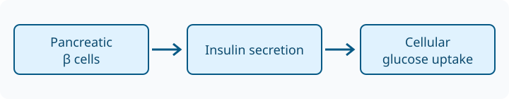

# Diabetes Mellitus

## Introduction

- Diabetes mellitus (**DM**) causes **persistent hyperglycemia** through inadequate insulin secretion, impaired insulin action, or both. [@niddk-overview]
  - Review the existing [library article](/articles/diabetes-mellitus) alongside this draft example.

## Pathophysiology

- **Type 1:** Immune-mediated β-cell destruction causes severe insulin deficiency; **insulin replacement is essential**. [@niddk-overview]
- **Type 2:** **Insulin resistance** and insufficient compensatory secretion raise plasma glucose. [@niddk-overview]
  - 
  - *Original schematic; receptor signaling and tissue-specific effects are omitted.*

## Presentation

- Hyperglycemia may be **symptomatic or detected on testing**; clinical presentation alone does not establish the diagnosis. [@niddk-diagnosis]
  - Consider the differential and confirm using **laboratory testing**, rather than a home glucose meter. [@niddk-diagnosis]

## Evaluation

- Diagnostic thresholds for **nonpregnant adults**: [@niddk-diagnosis]
  - **Fasting plasma glucose ≥ 126 mg/dL**, after at least **8 hours** fasting.
  - **2-hour oral glucose tolerance test ≥ 200 mg/dL**.
  - **HbA1c ≥ 6.5%**.
  - **Random plasma glucose ≥ 200 mg/dL** when diabetes symptoms are present.
  - Without unequivocal symptomatic hyperglycemia, obtain <mark data-highlight="emerald" class="theme-highlight theme-highlight-emerald">confirmatory testing</mark>.
  - > [!IMPORTANT]
    > **High-Yield (NL):** Pair a diagnostic glucose result with its clinical context; **symptomatic random glucose ≥ 200 mg/dL** is the key immediate-diagnosis pattern. [@niddk-diagnosis]
- <mark data-comment-id="comment_example_open" class="comment-highlight">HbA1c may be unreliable</mark> with some hemoglobin variants or altered red-cell conditions; consider **plasma glucose testing** when results disagree. [@niddk-diagnosis]
- Diagnostic reasoning:
  ```mermaid
  flowchart TD
    A[Laboratory glucose assessment] --> B{Classic symptoms and random glucose >= 200 mg/dL?}
    B -->|Yes| C[Diagnose diabetes and assess severity]
    B -->|No| D[Assess fasting glucose, HbA1c or OGTT]
    D --> E{Diagnostic threshold reached?}
    E -->|Yes| F[Confirm with repeat or second abnormal test]
    E -->|No| G[Assess risk and arrange appropriate follow-up]
  ```

## Treatment

- Establish an **individualized care plan**: nutrition, physical activity, prescribed medicines and glucose monitoring. [@niddk-management]
  - **Type 1 requires insulin**; type 2 therapy depends on the patient's needs. [@niddk-overview; @niddk-management]
  - Consult the [Thai national diabetes guideline](https://dmthai.org/new/index.php/activities-and-news/news-pr/naewthang-wech-ptibati-sahrab-rokh-bea-hwan-2566-chbab-prabprung-kph-67) for local treatment pathways.
  - Review **Metformin** eligibility and alternatives using that guideline; a terminology link is not a prescribing recommendation.
- Follow the **ABCs**: <span data-text-color="accent" class="theme-text theme-text-accent">A1c, blood pressure and cholesterol</span>, plus smoking cessation. [@niddk-management]
  - **HbA1c &lt; 7%** is a common goal; <span data-text-color="red" class="theme-text theme-text-red">individualize the target</span> according to patient circumstances. [@niddk-management]

## Complications

- Chronic hyperglycemia increases risk of **eye, kidney, nerve and cardiovascular disease**. [@niddk-overview; @niddk-management]
  - Thai mnemonic: <mark data-comment-id="comment_example_resolved" data-resolved="true" class="comment-highlight comment-highlight-resolved">ตา–ไต–ประสาท</mark> recalls the major microvascular targets.
  - Coordinate **glucose management, blood-pressure control, lipid management and complication surveillance**. [@niddk-management]
- Terminology review: [Diabetes mellitus](snomed:73211009) opens a concept preview in Studio and resolves to the library article at build time. Referenced concepts without articles, such as [Metformin](snomed:372567009), receive an article-pending stub without another AI pass.
